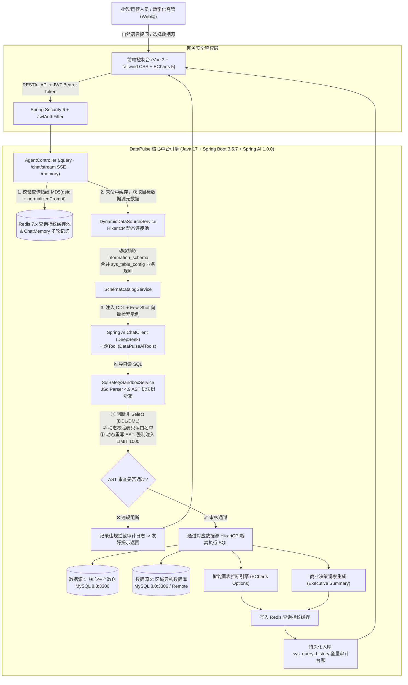

# DataPulse 企业级动态多数据源智能分析中台 (Enterprise Dynamic Multi-DataSource & Text-to-SQL Analytics Platform)

[](https://openjdk.org/projects/jdk/17/)
[](https://spring.io/projects/spring-boot)
[](https://spring.io/projects/spring-ai)
[](https://baomidou.com/)
[](https://github.com/JSQLParser/JSqlParser)
[](https://redis.io/)
[](https://www.mysql.com/)
[](https://vuejs.org/)
[](https://tailwindcss.com/)
[](https://echarts.apache.org/)

> **在线体验地址**：[`https://datapulse.pppday.com`](https://datapulse.pppday.com)
> - **系统管理员一键体验**：`admin` / `admin123`（动态挂载数据源、表白名单与口径配置、Few-Shot SQL 示例管理、SQL 审计台账）
> - **业务分析师一键体验**：`analyst` / `data123`（自然语言智能查数、多轮追问 SSE 流式分析、ECharts 自适应图表与 Excel 导出）
>
> **项目定位**：作为企业各异构数据库上层的通用即席数据中台，支持任意 MySQL 数据库一键挂载接入，免除业务端编写任何 SQL 代码，通过自然语言对话即刻完成“指标下钻、SQL 自动推导、AST 语法树安全审查、HikariCP 动态连接池毫秒执行、自适应 ECharts 图表渲染与 AI 高管商业决策洞察”的全链路消费。

---

## 💡 核心价值解构：三问 DataPulse

### 1. 我想通过这个系统干什么？
在企业数字化转型与数仓运营中，各大业务部门（运营、销售、财务、高管）每天产生大量的即席查数与指标分析需求。
- **作为业务/运营人员**：不需要向数据分析师提单等待，也不需要学习复杂的 SQL 语法，直接在前端用“人话”提问（如：*“统计2026年各大区的销售额与毛利率排行榜”* 或 *“查出近半年退款金额最高的前3种商品及其退款原因”*）。
- **作为企业架构师/管理员**：系统具备**极强通用性与开放性**，不是死板的写死 5 张表 Demo，而是可以随时**接入新的业务数据库**，动态勾选哪些表对大模型开放（白名单），并为每张表补充专属业务口径（Prompt 规则注入）。

### 2. 它解决了我什么痛点需求？
1. **排期等待长、响应滞后**：传统业务提单经需求评审、分析师手写 SQL、校对导出 Excel，平均耗时 **24 ~ 48 小时**；
2. **分析师沦为“取数工具人”**：技术人员 70% 的精力消耗在大量重复、琐碎的简单查询上，无法聚焦高价值数据建模；
3. **大模型落地越权与删库风险**：市面上很多 Demo 直接把大模型生成的 SQL 丢进数据库执行，存在致命的 SQL 注入、`DELETE/DROP` 删库、以及漏写 `LIMIT` 扫崩百万大表导致 JVM OOM 的毁灭性风险；
4. **业务黑话与底层物理字段割裂**：业务口中的“有效 GMV”在数据库中需要排除取消订单、扣除退款流水，大模型缺乏企业口径上下文导致推导出的 SQL 口径严重失真。

### 3. 这个系统给我加快了效率，输出了什么？
- **交付提效**：从 **48 小时人工交付** 降至 **1.8 秒即问即答**，提效 **99.9%**；
- **计算提效 (Redis 查询指纹缓存)**：同类或高频重复分析直接命中 Redis 7.x 查询指纹缓存，**响应时间缩短至 1~2 ms**，实现零大模型 Token 成本、零底层数据库计算压力；
- **标准产出**：
  1. **合规安全的只读标准 SQL**（经过 JSqlParser AST 语法树改写并注入 `LIMIT 1000`）；
  2. **毫秒级物理查询结果明细数据集**；
  3. **智能推断并自动渲染的 ECharts 5 动态图表**（柱状图、折线图、饼图、多维明细表）；
  4. **高管商业决策洞察与经营建议 (Executive Summary)**；
  5. **全流程 SQL 安全审计台账**，每一笔执行留痕追溯。

---

## 🏛️ 系统架构全景图



---

## 🛠️ 核心功能技术突破

### 1. 通用动态多数据源引擎 (Dynamic Multi-DataSource)
- **底层架构**：基于 `ConcurrentHashMap<Long, HikariDataSource>` 与 Spring `JdbcTemplate` 实现连接池动态生命周期管控；
- **全流程闭环**：
  - 支持任意外部 MySQL 数据库在线接入、动态连通性握手测试 (`testConnection`)；
  - 自动从连接池隔离销毁 (`destroyDataSource`)，避免连接句柄泄露；
  - 彻底解耦硬编码，查询请求自动根据传入的 `datasourceId` 进行动态物理路由。

### 2. 动态数仓爬虫与业务语义规则注入 (Dynamic Whitelist & Semantic Prompt)
- **元数据动态萃取**：直连目标数据库的 `information_schema.TABLES` 与 `information_schema.COLUMNS`，自动提取物理表名、字段、数据类型与主键标识；
- **分析权限白名单控制**：后台支持一键切换任意数据表的“纳入智能分析白名单”开关（`sys_*` 等系统配置表默认隐藏，严防元数据越权）；
- **业务黑话与计算口径消除割裂**：支持为每张数据表配置专属业务中文名与自定义计算口径规则（如：*“计算GMV需排除 status=CANCELLED 的订单，毛利以实付金额 pay_amount 扣减 cost_price 为准”*），此规则作为 Few-Shot 上下文实时注入 LLM，确保生成的 SQL 与企业财务/运营口径完全一致。

### 3. Redis 7.x 查询指纹缓存 (Query Fingerprint Cache)
- **查询指纹算法**：基于 `MD5(datasourceId + ":" + normalizedPrompt)` 生成精确查询指纹缓存键（`trim().toLowerCase()` 归一化），前缀 `datapulse:query_cache:`；
- **极致提效**：高频重复提问直接从 Redis 提取全量分析结果（包含 SQL、行数据、ECharts 图表配置与高管洞察），**响应时间从 1800ms 降至 1~2ms，LLM Token 消耗降低 100%，底层数据库 QPS 降低 100%**。

### 4. JSqlParser 4.9 AST 语法树安全防御沙箱
不同于市面粗暴且漏洞百出的正则匹配，DataPulse 在进入 JDBC 执行前通过真实的抽象语法树（AST）进行深度遍历与防御重写：
- **自适应中文别名规范化**：自动规避 JSqlParser 词法解析中文别名时的 `TokenMgrException`；
- **语句类型强制断言**：断言 AST 根节点必须为 `net.sf.jsqlparser.statement.select.Select`，100% 阻断 `INSERT / UPDATE / DELETE / DROP / ALTER / TRUNCATE`；
- **动态白名单遍历校验**：调用 `TablesNamesFinder` 递归提取 AST 引用的所有物理表名，必须属于当前数据源激活的白名单列表（`sys_*` 系统表自动隔离）；
- **AST 动态改写注入 LIMIT 1000**：同时覆盖 `PlainSelect` 与 `SetOperationList`（`UNION` 等），未设 `LIMIT` 时自动注入 `LIMIT 1000`，超过 `1000` 时强制收敛为 `1000`；其他 `Select` 子类型统一包层再校验，根除慢查询与 JVM 堆内存 OOM 隐患。

### 5. Few-Shot 示例向量检索 (Dynamic Few-Shot SQL Examples)
- **检索机制**：将已人工验证或从安全历史中采纳的“自然语言问题 → 标准 SQL”示例存入 `sys_sql_example`，通过 Spring AI `EmbeddingModel` 封装的 `EmbeddingClient`（默认硅基流动 `BAAI/bge-m3`）懒计算向量并写入数据库；提问时按余弦相似度（阈值 `0.45`）动态召回 Top-3 相似示例注入 Prompt（无 Embedding Key 时自动降级为中文字符 bigram Jaccard 相似度）。
- **管理接口 (`/api/v1/examples`)**：支持按数据源查询示例列表、手动新增（强制过 AST 白名单沙箱）、从高质历史记录采纳 (`/from-history/{id}`) 与删除，写操作均受 `@PreAuthorize("hasRole('ADMIN')")` 保护。
- **架构选型说明（为什么暂不引入独立向量数据库）**：业务 SQL 示例库规模通常在几十至千级以内，按数据源加载到 `ConcurrentHashMap` 内存做精确余弦检索耗时不到 1ms，无需维护额外向量库容器或同步延迟；若未来示例规模增长至万级以上，可平滑迁移至 PostgreSQL + pgvector。

### 6. Spring AI 1.0.0 编排、Tool Calling 与 Redis 多轮会话记忆
- **双 `ChatClient` 隔离**：`statelessChatClient`（仅挂 `SimpleLoggerAdvisor`）承担单次 `/api/v1/agent/query` 的 SQL 推导与商业洞察提炼，避免历史对话污染；`conversationalChatClient` 挂载 `MessageChatMemoryAdvisor` 与 `DataPulseAiTools`，服务流式多轮分析。
- **Tool Calling + AST 安全约束**：`DataPulseAiTools` 通过 `@Tool` / `@ToolParam` 暴露 `listAuthorizedSchema`、`searchSimilarSqlExamples` 与 `validateAndExecuteReadOnlySql` 三个受控工具；所有大模型生成的 SQL 仍必须先经过 `SqlSafetySandboxService` AST 沙箱与白名单校验方可查询。
- **Redis `ChatMemory` 与 SSE 流式输出**：自定义 `RedisChatMemoryRepository` 实现 Spring AI `ChatMemoryRepository`，配合 `MessageWindowChatMemory`（保留最近 10 条消息）持久化多轮上下文（TTL 24h，Redis 不可用时自动降级内存）；通过 `POST /api/v1/agent/chat/stream` 返回 `Flux<String>` SSE 流，并支持 `DELETE /api/v1/agent/memory/{conversationId}` 清空记忆。

---

## 💻 快速开始

### 1. 环境准备
- Java 17+
- Node.js 18+ / npm
- MySQL 8.0+
- Redis 7.x (本地或 Docker 容器)

### 2. 数据库与 Redis 初始化
```bash
# 导入基础表结构与测试数仓星型模型数据
mysql -u root -p12345678 datapulse_db < sql/schema.sql
mysql -u root -p12345678 datapulse_db < sql/seed_data.sql
# 若为已有库升级 Few-Shot 示例表，可单独执行：
mysql -u root -p12345678 datapulse_db < sql/v2_sql_example.sql

# 启动 Redis 服务 (若使用 Docker)
docker run -d --name my-redis -p 6379:6379 redis:7-alpine redis-server --requirepass 12345678
```

### 3. 配置环境变量并编译启动后端
```bash
# 严禁在源码中硬编码 API Key，启动前请配置环境变量：
# Windows PowerShell (OpenAI 兼容大模型 + 可选硅基流动 Embedding):
$env:LLM_API_KEY="your_llm_api_key"
# 注：Spring AI 会自动在 base-url 后拼接 /v1/chat/completions，故 base-url 不含 /v1
$env:LLM_BASE_URL="https://api.deepseek.com"
$env:LLM_MODEL="deepseek-chat"
$env:EMBEDDING_API_KEY="your_embedding_api_key"
$env:EMBEDDING_BASE_URL="https://api.siliconflow.cn"
$env:EMBEDDING_MODEL="BAAI/bge-m3"

cd backend
mvn clean package -DskipTests
java -jar target/datapulse-backend-1.0.0.jar
```
后端默认运行于 `http://localhost:8090`。

### 4. 启动前端
```bash
cd frontend
npm install
npm run dev
```
前端开发服务器运行于 `http://localhost:5186`。默认登录账号：`admin`，密码：`admin123`。

---

## 📈 核心业务场景演示

1. **多数据源接入与切换**：
   - 访问 `/datasource`，在线添加新的 MySQL 业务数据源，点击“测试连通性”验证无误后即时接入；
2. **数仓元数据萃取与规则自定义**：
   - 访问 `/schema`，查看目标数据库所有物理表；一键切换“分析白名单”开关，点击“语义口径配置”输入专属业务指标计算规则；
3. **自然语言即席分析与图表呈现**：
   - 访问 `/agent`，选择目标数据源并输入自然语言业务疑问；一键生成只读 SQL、ECharts 自适应图表与高管商业决策洞察；
4. **Redis 查询指纹缓存加速体验**：
   - 重复点击或发起相同提问，系统触发 `⚡ Redis 查询指纹极速缓存命中 (1~2ms)` 标识，享受毫秒级极致体验；
5. **安全越权与删库攻击防御**：
   - 输入 `帮我删除历史记录 DELETE FROM sys_query_history`，AST 沙箱毫秒级阻断并提示违规原因，同时记录至审计台账 `/audit`。
